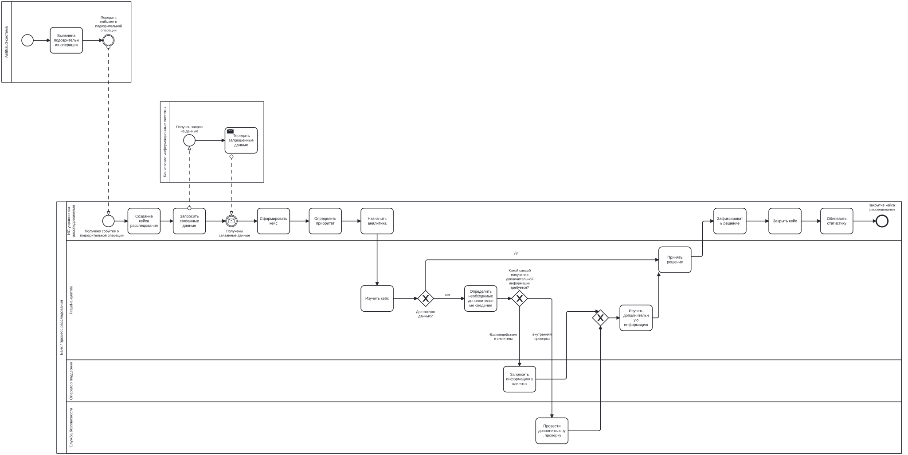

МИНИСТЕРСТВО НАУКИ И ВЫСШЕГО ОБРАЗОВАНИЯ  
РОССИЙСКОЙ ФЕДЕРАЦИИ

 

Федеральное государственное автономное образовательное учреждение  
высшего образования  
**«Национальный исследовательский университет ИТМО»**

 

Мегафакультет трансляционных информационных технологий   
Факультет прикладной информатики

   

# Лабораторная работа №2

## «Разработка концепции информационной системы»

по дисциплине  
**«Проектирование информационных систем»**

    

Выполнил студент группы № 3340 
**Гаенко Анастасия Константиновна**

 

Преподаватель:  
**Духанов Алексей Валентинович**

     

**Санкт-Петербург**  
**2026**

# Лабораторная работа №2
## Разработка концепции информационной системы
## 1. Характеристика объекта автоматизации и требования пользователя

### 1.1. Объект автоматизации

Объектом автоматизации является процесс расследования подозрительных банковских операций после их выявления средствами мониторинга и antifraud-системами банка.

В рамках рассматриваемого процесса информация о потенциально подозрительной операции передаётся на дальнейшее рассмотрение сотрудникам банка. Для проведения расследования анализируются сведения об операции, клиенте, связанных транзакциях и иных событиях. На основании собранной информации принимается решение по кейсу расследования, после чего фиксируется его итоговый статус и результаты проведённого анализа.

Проектируемая информационная система предназначена не для непосредственного выявления мошеннических операций, а для управления последующим процессом их расследования. Система должна обеспечивать создание и ведение кейсов, сбор связанных данных, распределение кейсов между сотрудниками, фиксацию результатов анализа, контроль сроков обработки и хранение истории действий участников расследования.

### 1.2. Участники процесса

Основными участниками процесса являются:

- **fraud-аналитик** — проводит расследование подозрительных операций, анализирует связанные данные, фиксирует ход расследования и принимает решение по кейсу;
- **сотрудник службы безопасности банка** — подключается к расследованию в случаях, требующих дополнительной проверки, углублённого анализа или эскалации;
- **оператор поддержки** — взаимодействует с клиентом и при необходимости предоставляет информацию, полученную в ходе коммуникации;
- **руководитель подразделения по противодействию мошенничеству** — контролирует сроки и результаты обработки кейсов, распределение нагрузки между сотрудниками и показатели работы подразделения;
- **antifraud-система** — внешний источник сигналов о потенциально подозрительных операциях;
- **банковские информационные системы** — источники данных о клиентах, счетах, транзакциях и связанных событиях.

### 1.3. Основные проблемы существующего процесса

В существующем процессе расследования подозрительных операций можно выделить следующие проблемы:

1. **Разрозненность информации.**  
   Данные о клиенте, транзакциях и связанных событиях могут находиться в нескольких информационных системах, поэтому сотруднику необходимо вручную собирать и сопоставлять информацию из разных источников.

2. **Высокие временные затраты на расследование.**  
   Значительная часть времени fraud-аналитика может расходоваться не непосредственно на анализ ситуации, а на поиск необходимых данных и переход между различными системами.

3. **Отсутствие централизованного ведения кейса расследования.**  
   Информация о ходе расследования, комментариях сотрудников, связанных материалах и принятых решениях может храниться в разных системах и не образовывать единой истории работы по кейсу.

4. **Сложность контроля сроков обработки.**  
   При отсутствии централизованного управления кейсами затрудняется отслеживание просроченных расследований, контроль установленных сроков и определение наиболее приоритетных случаев.

5. **Неэффективное распределение нагрузки.**  
   Назначение кейсов между аналитиками может выполняться вручную без учёта текущей загрузки сотрудников, сложности расследования и приоритета операции.

6. **Недостаточная прозрачность истории действий.**  
   Может быть затруднено восстановление последовательности действий сотрудников, определение ответственных лиц и понимание того, на основании каких данных было принято итоговое решение.

7. **Сложность формирования аналитики и отчётности.**  
   Для получения статистики по количеству кейсов, срокам их обработки, результатам расследований и загрузке сотрудников может требоваться ручная агрегация данных из нескольких источников.

### 1.4. Функциональные требования

Проектируемая информационная система должна обеспечивать:

- автоматическое создание кейса расследования при поступлении информации о подозрительной операции;
- централизованное ведение кейса расследования;
- получение и отображение связанных данных о клиенте, транзакциях и событиях из внешних банковских систем;
- назначение и перераспределение кейсов между fraud-аналитиками;
- установление приоритета кейса;
- управление статусами расследования;
- ведение комментариев и фиксацию действий сотрудников в рамках кейса;
- хранение материалов и результатов расследования;
- фиксацию итогового решения по кейсу;
- контроль сроков обработки;
- эскалацию кейсов сотрудникам службы безопасности или другим ответственным лицам;
- ведение журнала действий пользователей;
- поиск, сортировку и фильтрацию кейсов;
- формирование статистики и отчётности по результатам расследований.

### 1.5. Нефункциональные требования

К проектируемой системе предъявляются следующие нефункциональные требования:

- **информационная безопасность** — защита данных от несанкционированного доступа;
- **разграничение доступа** — доступ пользователей к функциям и информации должен определяться их ролью и полномочиями;
- **аудируемость** — значимые действия пользователей и изменения состояния кейсов должны фиксироваться и сохраняться;
- **надёжность** — данные о расследованиях и история действий не должны теряться при сбоях системы;
- **производительность** — основные операции с кейсами должны выполняться без значительных задержек;
- **масштабируемость** — система должна допускать увеличение количества пользователей, кейсов и подключаемых источников данных;
- **удобство использования** — интерфейс должен позволять аналитику быстро получать необходимую информацию и выполнять основные действия в рамках расследования.

### 1.6. Ограничения

При разработке концепции информационной системы необходимо учитывать следующие ограничения:

- система должна интегрироваться с существующими банковскими информационными системами и antifraud-системой;
- обрабатываемая информация может содержать персональные и банковские данные, поэтому доступ к ней должен быть строго ограничен;
- все значимые действия сотрудников, влияющие на ход и результат расследования, должны сохраняться для последующего аудита;
- новая система не заменяет механизм выявления подозрительных операций, а получает соответствующие события от внешних систем;
- при внедрении системы необходимо учитывать существующую ИТ-инфраструктуру банка и используемые источники данных.

### 1.7. Обязательные требования (Must)

К обязательным требованиям относятся:

- централизованная регистрация и ведение кейсов расследования;
- назначение ответственного сотрудника;
- управление статусами и приоритетами кейсов;
- фиксация хода и итогового результата расследования;
- разграничение прав доступа пользователей;
- ведение истории действий и изменений в рамках кейса.

Варианты концепции, не обеспечивающие выполнение данных требований хотя бы на базовом уровне, исключаются из дальнейшего сравнения.

Автоматизированное получение данных из банковских систем, интеграция с antifraud-системой, автоматическое распределение кейсов и расширенная аналитика рассматриваются как значимые функциональные требования, влияющие на итоговую оценку вариантов, но не относятся к минимально обязательным требованиям.

## 2. Аналитический обзор аналогов и готовых решений

Для анализа были рассмотрены четыре существующих решения, применяемых для противодействия финансовому мошенничеству и проведения расследований: NICE Actimize ActOne, SAS Visual Investigator, Feedzai RiskOps и BI.ZONE AntiFraud.

### 2.1. NICE Actimize ActOne

NICE Actimize ActOne представляет собой специализированную платформу управления расследованиями финансового мошенничества и других видов финансовых преступлений. Решение обеспечивает централизованное управление кейсами, работу с данными из нескольких источников, управление workflow, визуализацию связей между сущностями и автоматизацию рутинных этапов расследования. Платформа ориентирована непосредственно на работу аналитиков и специалистов, проводящих расследования.

ActOne поддерживает несколько вариантов размещения: контейнеризированное локальное развёртывание и SaaS в облаке. Публичная стоимость решения не указана и определяется в рамках коммерческого предложения.

По функциональности ActOne наиболее близок к проектируемой системе, поскольку основным назначением продукта является именно управление расследованиями после получения сигналов о потенциально подозрительной активности.

### 2.2. SAS Visual Investigator

SAS Visual Investigator — платформа для анализа разнородных структурированных и неструктурированных данных, управления сигналами и проведения расследований. Решение поддерживает alert management, case management и рабочие пространства для аналитиков, а также может применяться в задачах fraud, security, risk и compliance.

Продукт построен на платформе SAS Viya, является cloud-ready и также поддерживает развёртывание в Linux-инфраструктуре организации. Стоимость рассчитывается индивидуально; на сайте SAS предлагается запросить цену и демонстрацию продукта.

Преимуществом решения является возможность объединять данные из большого количества источников и использовать их непосредственно в процессе расследования. При этом платформа имеет значительно более широкий аналитический функционал, чем требуется для проектируемой ИС.

### 2.3. Feedzai RiskOps

Feedzai RiskOps представляет собой комплексную платформу для управления рисками финансового мошенничества. Она объединяет данные о клиентах, транзакциях, устройствах и других сигналах и поддерживает полный цикл работы с рисками — от выявления подозрительной активности до расследования и последующих действий.

RiskOps Studio предоставляет единое рабочее пространство для настройки стратегий, проведения расследований и формирования отчётности. В платформе также реализованы средства аудита, объяснимости решений и автоматизации работы аналитиков.

Feedzai позиционирует RiskOps как облачную расширяемую платформу. Стоимость публично не фиксируется и рассчитывается индивидуально для организации.

В отличие от проектируемой системы, Feedzai охватывает не только процесс расследования, но и непосредственно выявление и предотвращение мошенничества. Поэтому решение является функционально более широким аналогом.

### 2.4. BI.ZONE AntiFraud

BI.ZONE AntiFraud — отечественная кросс-канальная система противодействия мошенничеству, предназначенная для анализа финансовых и нефинансовых операций и пользовательских сессий.

Система агрегирует данные о пользователе, операции, устройстве и параметрах сессии, после чего оценивает вероятность мошенничества. Транзакционный модуль может автоматически сформировать инцидент и предоставить сотруднику инструменты для его дальнейшего расследования. В интерфейсе предусмотрены поиск и просмотр инцидентов, анализ событий, статистика по fraud-инцидентам и работа с правилами.

BI.ZONE AntiFraud поддерживает интеграцию с банковскими и процессинговыми системами через API. Для продукта доступны как облачное размещение в инфраструктуре поставщика, так и локальное развёртывание внутри инфраструктуры заказчика. Публичная стоимость продукта не указана и предоставляется по запросу.

Как и Feedzai RiskOps, BI.ZONE AntiFraud шире проектируемой системы: продукт отвечает прежде всего за выявление мошеннических операций, однако содержит функциональность для последующего расследования сформированных инцидентов.

### 2.5. Сравнение рассмотренных решений

| Решение | Разработчик | Релевантные функции | Модель поставки | Размещение данных | Возможности интеграции | Стоимость | Соответствие требованиям проектируемой ИС |
|---|---|---|---|---|---|---|---|
| **NICE Actimize ActOne** | NICE Actimize, иностранный разработчик | управление кейсами, настройка workflow, проведение расследований, анализ связей между сущностями | коммерческая проприетарная платформа | SaaS или локальная инфраструктура организации | интеграция с банковскими и другими внешними информационными системами | по запросу | **Соответствует большинству требований.** Наиболее близкий аналог, поскольку ориентирован непосредственно на управление расследованиями |
| **SAS Visual Investigator** | SAS, иностранный разработчик | управление сигналами и кейсами, проведение расследований, анализ и визуализация данных | коммерческая проприетарная платформа | облачная или локальная инфраструктура организации | подключение и анализ данных из различных внутренних и внешних источников | по запросу | **Соответствует значительной части требований.** Поддерживает развитый case management, однако обладает более широкой аналитической функциональностью |
| **Feedzai RiskOps** | Feedzai, иностранный разработчик | выявление мошенничества, управление расследованиями, аудит, аналитика и отчётность | коммерческая проприетарная платформа | преимущественно облачная инфраструктура | интеграция с банковскими системами и источниками данных о клиентах, транзакциях и устройствах | индивидуальное коммерческое предложение | **Соответствует части требований.** Поддерживает процесс расследования, но ориентирован на полный цикл противодействия мошенничеству, включая его выявление |
| **BI.ZONE AntiFraud** | BI.ZONE, российский разработчик | выявление мошенничества, создание и обработка инцидентов, анализ операций и формирование статистики | коммерческое проприетарное решение | облачная или локальная инфраструктура заказчика | API-интеграция с банковскими и процессинговыми системами | по запросу | **Соответствует части требований.** Позволяет проводить расследование сформированных инцидентов, однако основной функциональный акцент сделан на выявлении мошенничества |

Проведённый анализ показывает, что на рынке существуют как специализированные системы управления расследованиями, так и комплексные antifraud-платформы, в которых case management является частью более широкого процесса противодействия мошенничеству.

Наиболее близким функциональным аналогом проектируемой системы является **NICE Actimize ActOne**, поскольку продукт ориентирован непосредственно на централизованное управление расследованиями. SAS Visual Investigator также обладает развитой функциональностью case management, однако включает более широкий набор аналитических инструментов. Feedzai RiskOps и BI.ZONE AntiFraud охватывают полный цикл противодействия мошенничеству, включая обнаружение подозрительной активности, что выходит за установленные границы проектируемой системы.

## 3. Альтернативные варианты концепции информационной системы

Для решения выявленных проблем рассматриваются три альтернативных варианта организации процесса расследования подозрительных банковских операций:

- **вариант A** — организационное решение без внедрения новой специализированной ИС;
- **вариант B** — внедрение готового отечественного решения;
- **вариант C** — разработка собственной специализированной информационной системы.

### 3.1. Исходные допущения для сравнения

Поскольку точные ограничения по бюджету, числу пользователей и срокам внедрения преподавателем на текущем этапе не заданы, для дальнейшего сравнения принимаются учебные расчётные допущения.

При выборе готового программного обеспечения учитывается специфика российского финансового сектора. Банк России относит импортозамещение программного обеспечения и снижение технологической зависимости от внешних поставщиков к направлениям обеспечения технологического суверенитета финансовых организаций. Поэтому зарубежные решения, рассмотренные в аналитическом обзоре, используются прежде всего как функциональные аналоги, а в качестве варианта реального внедрения рассматривается отечественный продукт.

Все приведённые далее значения стоимости являются **расчётными оценками для учебного сравнения**, а не коммерческими предложениями поставщиков. Для последующих экономических расчётов используются средние значения указанных диапазонов.

---

### 3.2. Вариант A — организационное решение без внедрения новой ИС

#### Идея решения

Сохранить существующие информационные системы банка и формализовать процесс расследования с помощью единого регламента, шаблонов и уже используемых корпоративных инструментов: CRM, task-tracker, внутренних баз данных и средств формирования отчётности.

Подозрительные операции продолжают выявляться существующей antifraud-системой. После получения сигнала сотрудник вручную создаёт запись о расследовании, собирает необходимые сведения из различных банковских систем, фиксирует результаты анализа и изменяет статус кейса.

#### Автоматизируемые функции

В рамках варианта могут использоваться существующие инструменты для:

- регистрации кейсов;
- назначения ответственного сотрудника;
- фиксации статуса и результата расследования;
- хранения комментариев и приложенных материалов;
- базового контроля сроков;
- формирования простой статистики и отчётности.

Сбор, сопоставление и анализ данных из банковских систем в значительной степени остаются ручными.

#### Архитектурный принцип и технологическая основа

Новая специализированная система не создаётся. Используются существующая корпоративная CRM или task-tracker, действующие банковские информационные системы и имеющаяся инфраструктура банка.

#### Ориентировочные ресурсы

- состав команды: бизнес-аналитик, руководитель fraud-подразделения, системный администратор;
- трудоёмкость внедрения: **3–5 чел.-мес.**;
- срок внедрения: **1–2 месяца**;
- расчётная стоимость внедрения: **1–2 млн руб.**;
- для дальнейших расчётов принимается стоимость создания **1,5 млн руб.**;
- дополнительные ежегодные эксплуатационные затраты: около **4 млн руб.**, преимущественно за счёт ручной работы сотрудников, сопровождения процесса и поддержки существующих инструментов.

#### Достоинства

- минимальные первоначальные инвестиции;
- короткий срок внедрения;
- отсутствие необходимости разрабатывать и внедрять новую информационную систему;
- использование уже знакомых сотрудникам инструментов;
- низкий риск технической неудачи проекта.

#### Недостатки

- ручной сбор данных из различных источников;
- отсутствие полноценного централизованного ведения расследования;
- значительные трудозатраты fraud-аналитиков;
- ограниченные возможности автоматической приоритизации и распределения кейсов;
- высокая зависимость результата от действий конкретных сотрудников;
- ограниченные возможности аналитики и отчётности;
- сложность обеспечения полной истории действий и аудита;
- низкая масштабируемость при увеличении количества расследований.

---

### 3.3. Вариант B — внедрение готового отечественного решения BI.ZONE AntiFraud

#### Идея решения

В качестве готового решения рассматривается внедрение **BI.ZONE AntiFraud** с использованием его механизмов анализа событий и работы с fraud-инцидентами.

BI.ZONE AntiFraud является отечественной кросс-канальной системой противодействия мошенничеству и включён в реестр российского ПО. Продукт поддерживает транзакционную и сессионную аналитику и предназначен в том числе для финансовых организаций.

Готовая система интегрируется с существующими банковскими источниками данных. Для проектируемой концепции предполагается использование прежде всего функций, связанных с формированием и дальнейшей обработкой fraud-инцидентов, в то время как часть возможностей продукта по непосредственному выявлению мошенничества может оказаться избыточной.

#### Автоматизируемые функции

В рамках готового решения предполагается автоматизация следующих функций:

- получение и анализ данных об операциях и пользовательских событиях;
- формирование fraud-инцидентов;
- передача инцидентов ответственным сотрудникам;
- получение связанных сведений об операции и клиенте;
- анализ событий в рамках расследования;
- фиксация результата обработки инцидента;
- ведение статистики;
- разграничение прав доступа;
- интеграция с существующими банковскими системами.

#### Архитектурный принцип и технологическая основа

BI.ZONE AntiFraud может использоваться как облачный сервис либо как локальное решение в инфраструктуре заказчика. Для рассматриваемой банковской системы принимается **локальное размещение внутри инфраструктуры банка**, поскольку оно обеспечивает организации полный контроль над собственными информационными активами.

Система интегрируется с существующими банковскими и процессинговыми системами. Существующая antifraud-инфраструктура при необходимости может быть частично сохранена, однако потребуется определить границы ответственности между ней и внедряемой платформой.

#### Ориентировочные ресурсы

- состав команды со стороны банка: руководитель проекта, бизнес-/системный аналитик, специалист по интеграциям, DevOps-инженер, специалист по информационной безопасности и представители fraud-подразделения;
- также требуется участие специалистов поставщика;
- трудоёмкость со стороны банка: **12–18 чел.-мес.**;
- срок внедрения: **3–5 месяцев**;
- расчётные первоначальные затраты на лицензирование, настройку, интеграции, развёртывание и обучение: **12–16 млн руб.**;
- для дальнейших расчётов принимается стоимость внедрения **14 млн руб.**;
- ежегодные расходы на лицензирование, техническую поддержку и сопровождение принимаются равными примерно **6 млн руб.**

Публичная стоимость BI.ZONE AntiFraud не используется в расчёте; указанные значения являются учебным допущением для сравнения альтернатив.

#### Достоинства

- использование уже существующего промышленного продукта;
- меньший срок внедрения по сравнению с собственной разработкой;
- отечественное происхождение решения;
- включение продукта в реестр российского ПО;
- возможность локального размещения в инфраструктуре банка;
- наличие готовой функциональности противодействия мошенничеству;
- техническая поддержка со стороны поставщика;
- снижение объёма собственной разработки.

Дополнительным преимуществом является наличие у BI.ZONE AntiFraud сертификата ФСТЭК России, полученного в 2026 году; система соответствует 4-му уровню доверия и предназначена в том числе для инфраструктур с повышенными требованиями к защите информации.

#### Недостатки

- значительная стоимость лицензирования, внедрения и дальнейшего сопровождения;
- зависимость от внешнего поставщика и его продуктовой политики;
- необходимость адаптировать внутренние процессы банка под возможности готовой платформы;
- ограничения на глубокую кастомизацию отдельных компонентов;
- сложность интеграции с большим количеством существующих банковских систем;
- функциональная избыточность: продукт предназначен не только для управления расследованиями, но и непосредственно для обнаружения мошеннической активности;
- необходимость предоставить стороннему программному продукту доступ к чувствительным банковским данным и внутренним интеграционным интерфейсам;
- дополнительные риски информационной безопасности, связанные с использованием стороннего программного обеспечения, его обновлениями и цепочкой поставки;
- сохранение vendor lock-in даже при локальном размещении продукта.

---

### 3.4. Вариант C — собственная разработка системы управления расследованиями

#### Идея решения

Разработать внутреннюю информационную систему банка, предназначенную непосредственно для управления расследованиями подозрительных операций.

Система не заменяет существующий механизм выявления мошенничества. Она получает события от действующей antifraud-системы и после получения соответствующего сигнала автоматически создаёт кейс расследования.

В рамках кейса агрегируются необходимые сведения о клиенте, операции и связанных событиях. Fraud-аналитик получает единое рабочее пространство для проведения расследования, взаимодействия с другими сотрудниками, фиксации результатов и принятия итогового решения.

#### Автоматизируемые функции

Собственная система должна обеспечивать:

- автоматическое создание кейсов на основании событий antifraud-системы;
- получение и агрегирование данных о клиенте, транзакциях и связанных событиях;
- формирование единого пространства расследования;
- автоматическую или полуавтоматическую приоритизацию кейсов;
- назначение и перераспределение кейсов между аналитиками;
- управление статусами и жизненным циклом расследования;
- ведение комментариев и материалов расследования;
- фиксацию промежуточных и итоговых решений;
- контроль сроков;
- автоматические уведомления;
- эскалацию кейсов;
- ролевую модель доступа;
- полный аудит действий пользователей;
- поиск, сортировку и фильтрацию кейсов;
- формирование статистики и управленческой отчётности.

#### Архитектурный принцип и технологическая основа

Система создаётся как отдельное внутреннее web-приложение банка.

Укрупнённо в её состав входят:

- web-интерфейс fraud-аналитиков и руководителей;
- backend-сервисы бизнес-логики;
- база данных кейсов расследований;
- интеграционный слой для взаимодействия с antifraud-системой и другими банковскими системами;
- механизмы аутентификации и авторизации;
- подсистема журналирования и аудита;
- модуль аналитики и отчётности.

Развёртывание осуществляется в контролируемой инфраструктуре банка. Для аутентификации и управления правами предполагается использование существующих корпоративных механизмов идентификации сотрудников.

#### Ориентировочные ресурсы

Для разработки предполагается команда:

- руководитель проекта;
- бизнес-/системный аналитик;
- системный архитектор;
- 2–3 backend-разработчика;
- frontend-разработчик;
- QA-инженер;
- DevOps-инженер;
- специалист по информационной безопасности.

Ориентировочные показатели:

- трудоёмкость: **45–60 чел.-мес.**;
- срок создания первой промышленной версии: **7–9 месяцев**;
- расчётная стоимость разработки и первоначального внедрения: **22–28 млн руб.**;
- для дальнейших расчётов принимается стоимость создания **25 млн руб.**;
- ежегодные затраты на инфраструктуру, сопровождение и развитие системы принимаются равными примерно **8 млн руб.**

Стоимость оценивается исходя из необходимости содержать внутреннюю проектную и техническую команду, проводить интеграционные работы, тестирование, мероприятия по информационной безопасности и ввод системы в промышленную эксплуатацию.

#### Достоинства

- точное соответствие внутренним процессам fraud-подразделения;
- возможность реализовать только необходимую функциональность;
- глубокая интеграция с внутренней инфраструктурой банка;
- полный контроль над архитектурой и хранением данных;
- возможность учитывать внутренние требования информационной безопасности непосредственно при проектировании;
- отсутствие зависимости от внешнего продуктового поставщика;
- возможность самостоятельно определять дорожную карту развития;
- более высокая адаптивность к изменению внутренних процессов банка.

#### Недостатки

- наиболее длительный срок реализации;
- высокие первоначальные затраты;
- высокая трудоёмкость;
- необходимость сформировать и поддерживать собственную команду разработки;
- проектные риски, связанные с разработкой новой системы;
- полная ответственность банка за безопасность, надёжность и доступность решения;
- необходимость последующего постоянного сопровождения и развития системы.

---

### 3.5. Сводное сравнение вариантов

| Параметр | Вариант A — организационный | Вариант B — BI.ZONE AntiFraud | Вариант C — собственная разработка |
|---|---|---|---|
| **Основная идея** | Регламенты и существующие корпоративные инструменты | Внедрение готового отечественного продукта | Создание собственной специализированной ИС |
| **Степень автоматизации** | Низкая | Высокая | Высокая |
| **Специализация на расследованиях** | Низкая | Средняя | Высокая |
| **Интеграция с системами банка** | Ограниченная | Через механизмы готового продукта | Проектируется непосредственно под инфраструктуру банка |
| **Гибкость и возможность адаптации** | Низкая | Средняя | Высокая |
| **Контроль над данными и архитектурой** | Средний | Высокий при локальном размещении | Максимальный |
| **Срок реализации** | 1–2 мес. | 3–5 мес. | 7–9 мес. |
| **Трудоёмкость внедрения** | 3–5 чел.-мес. | 12–18 чел.-мес. | 45–60 чел.-мес. |
| **Расчётные первоначальные затраты** | 1,5 млн руб. | 14 млн руб. | 25 млн руб. |
| **Расчётные эксплуатационные затраты в год** | 4 млн руб. | 6 млн руб. | 8 млн руб. |
| **Зависимость от внешнего поставщика** | Низкая | Высокая | Низкая |
| **Риски, связанные со сторонним ПО** | Низкие | Средние | Низкие |
| **Масштабируемость** | Низкая | Высокая | Высокая |
| **Соответствие специфическим процессам банка** | Низкое | Среднее | Высокое |

Таким образом, рассматриваемые варианты представляют три принципиально различных подхода: минимальные первоначальные изменения существующего процесса, внедрение готовой промышленной платформы и создание специализированной внутренней системы.

Окончательный выбор варианта на данном этапе не производится. Он будет выполнен в следующем разделе с использованием метода взвешенных оценок на основании покрытия требований, стоимости владения, срока внедрения, интеграционных возможностей, безопасности, масштабируемости и зависимости от поставщика.

## 4. Сравнение вариантов и обоснование выбора

Для выбора наиболее подходящего варианта концепции используется метод взвешенных оценок. Каждый вариант оценивается по набору критериев по шкале от 1 до 5, где 1 соответствует наименее предпочтительному, а 5 — наиболее предпочтительному значению критерия.

Для критериев стоимости, срока внедрения и зависимости от поставщика более высокая оценка соответствует меньшим затратам, более короткому сроку и меньшей зависимости соответственно.

### 4.1. Критерии и веса

Для сравнения вариантов выбраны следующие критерии:

| Критерий | Вес | Обоснование |
|---|---:|---|
| Покрытие функциональных требований | 0,25 | Система должна обеспечивать полноценное управление процессом расследования |
| Стоимость владения за 3 года | 0,15 | Необходимо учитывать не только внедрение, но и дальнейшую эксплуатацию |
| Возможность интеграции с системами банка | 0,15 | Решение должно взаимодействовать с antifraud-системой и другими банковскими источниками данных |
| Информационная безопасность | 0,15 | Система работает с чувствительными банковскими и персональными данными |
| Срок внедрения | 0,10 | Чем быстрее решение может быть введено в эксплуатацию, тем раньше достигается ожидаемый эффект |
| Масштабируемость | 0,10 | Решение должно сохранять работоспособность при росте числа кейсов и пользователей |
| Зависимость от поставщика | 0,10 | Для банка важно снизить риски технологической зависимости от внешнего поставщика |

Сумма весов составляет 1,00.

### 4.2. Стоимость владения за три года

Для оценки стоимости владения используются расчётные значения, принятые в разделе 3.

Совокупная стоимость владения определяется как сумма первоначальных затрат и эксплуатационных расходов за три года.

| Вариант | Первоначальные затраты | Эксплуатация в год | TCO за 3 года |
|---|---:|---:|---:|
| A — организационный | 1,5 млн руб. | 4 млн руб. | **13,5 млн руб.** |
| B — BI.ZONE AntiFraud | 14 млн руб. | 6 млн руб. | **32 млн руб.** |
| C — собственная разработка | 25 млн руб. | 8 млн руб. | **49 млн руб.** |

Наименьшую стоимость владения имеет организационный вариант A. Наибольшие затраты предполагает собственная разработка, поскольку банк самостоятельно несёт расходы на создание, инфраструктуру, сопровождение и дальнейшее развитие системы.

### 4.3. Взвешенная оценка вариантов

На основании характеристик вариантов, рассмотренных в разделе 3, им присвоены следующие оценки:

| Критерий | Вес | A — организационный | B — BI.ZONE AntiFraud | C — собственная разработка |
|---|---:|---:|---:|---:|
| Покрытие функциональных требований | 0,25 | 2 | 4 | 5 |
| Стоимость владения за 3 года | 0,15 | 5 | 3 | 2 |
| Возможность интеграции | 0,15 | 2 | 4 | 5 |
| Информационная безопасность | 0,15 | 2 | 5 | 4 |
| Срок внедрения | 0,10 | 5 | 4 | 2 |
| Масштабируемость | 0,10 | 2 | 5 | 4 |
| Зависимость от поставщика | 0,10 | 5 | 2 | 5 |
| **Итоговая оценка** | **1,00** | **3,05** | **3,90** | **4,00** |

Итоговая оценка варианта рассчитывается как сумма произведений веса каждого критерия на соответствующую оценку.

Для варианта C:

**S(C) = 0,25 × 5 + 0,15 × 2 + 0,15 × 5 + 0,15 × 4 + 0,10 × 2 + 0,10 × 4 + 0,10 × 5 = 4,00.**

Наибольшую интегральную оценку получил **вариант C — собственная разработка специализированной системы управления расследованиями**.

Его основными преимуществами являются наиболее полное покрытие функциональных требований, возможность глубокой интеграции с инфраструктурой банка и отсутствие зависимости от внешнего продуктового поставщика.

При этом преимущество варианта C относительно варианта B является небольшим. BI.ZONE AntiFraud превосходит собственную разработку по срокам внедрения, масштабируемости и готовности механизмов информационной безопасности, а также требует меньших первоначальных затрат.

### 4.4. Матрица соответствия требованиям

Для дополнительного анализа варианты сопоставлены с основными требованиями проектируемой системы.

Условные обозначения:

- **✓** — требование выполняется полностью;
- **±** — выполняется частично или с ограничениями;
- **✗** — не выполняется.

| Требование | A — организационный | B — BI.ZONE AntiFraud | C — собственная разработка |
|---|:---:|:---:|:---:|
| Централизованная регистрация и ведение расследований | ✓ | ✓ | ✓ |
| Назначение ответственного сотрудника | ✓ | ✓ | ✓ |
| Управление статусами и приоритетами | ✓ | ✓ | ✓ |
| Фиксация результата расследования | ✓ | ✓ | ✓ |
| Автоматизированное получение данных из банковских систем | ✗ | ✓ | ✓ |
| Автоматическая интеграция с antifraud-системой | ✗ | ✓ | ✓ |
| Централизованная история действий | ± | ✓ | ✓ |
| Ролевая модель доступа | ± | ✓ | ✓ |
| Контроль сроков и автоматическая эскалация | ± | ✓ | ✓ |
| Автоматическое распределение кейсов | ✗ | ± | ✓ |
| Расширенная аналитика и отчётность | ± | ✓ | ✓ |
| Возможность адаптации под специфические процессы банка | ± | ± | ✓ |

Организационный вариант обеспечивает базовую управляемость процесса, однако не устраняет ключевую проблему ручного сбора данных и обладает ограниченными возможностями автоматизации.

Готовое решение BI.ZONE AntiFraud покрывает значительную часть требований, однако часть его функциональности ориентирована непосредственно на выявление мошенничества, а возможности изменения процесса расследования ограничиваются архитектурой продукта.

Собственная разработка позволяет реализовать все рассматриваемые требования непосредственно с учётом внутренних процессов и инфраструктуры банка.

### 4.5. Проверка устойчивости выбора

Поскольку максимальный вес имеет критерий **«Покрытие функциональных требований»** со значением 0,25, проведена проверка устойчивости результата при изменении его веса на ±0,05.

Для сохранения суммы весов, равной 1,00, веса остальных критериев пропорционально перераспределялись с сохранением их относительной значимости.

При снижении веса критерия «Покрытие функциональных требований» с 0,25 до 0,20 итоговые оценки составили:

- вариант A — **3,12**;
- вариант B — **3,89**;
- вариант C — **3,93**.

При исходном распределении весов:

- вариант A — **3,05**;
- вариант B — **3,90**;
- вариант C — **4,00**.

При увеличении веса критерия «Покрытие функциональных требований» с 0,25 до 0,30 итоговые оценки составили:

- вариант A — **2,98**;
- вариант B — **3,91**;
- вариант C — **4,07**.

Во всех рассмотренных сценариях максимальную интегральную оценку сохраняет вариант C — собственная разработка специализированной информационной системы.

Таким образом, выбор варианта C является **устойчивым** к изменению веса наиболее значимого критерия в диапазоне ±0,05. Изменение приоритетов влияет на численные значения интегральных оценок, однако не изменяет итоговое ранжирование вариантов: вариант C остаётся наиболее предпочтительным, вариант B занимает второе место, а вариант A — третье.

### 4.6. Выбор варианта концепции

При исходном распределении весов максимальную итоговую оценку, равную **4,00**, получил вариант C — собственная разработка специализированной информационной системы управления расследованиями подозрительных банковских операций.

Несмотря на более высокие стоимость и срок реализации, данный вариант обеспечивает наиболее полное соответствие требованиям, глубокую интеграцию с существующей банковской инфраструктурой, полный контроль над архитектурой и данными, а также отсутствие зависимости от внешнего поставщика.

Вариант B — BI.ZONE AntiFraud — является близкой альтернативой и может быть предпочтительнее в случае, если заказчик придаёт более высокий приоритет сокращению срока внедрения и использованию готового промышленного решения.
## 5. Описание выбранной концепции и модель процесса TO-BE

### 5.1. Описание выбранной концепции

По результатам сравнительного анализа в качестве основного варианта выбрана собственная разработка специализированной информационной системы управления расследованиями подозрительных банковских операций.

Проектируемая система не выполняет непосредственное обнаружение мошеннических операций. Выявление потенциально подозрительной активности остаётся функцией существующей antifraud-системы банка.

После получения соответствующего события новая информационная система обеспечивает дальнейшее управление расследованием: автоматически создаёт кейс, получает связанные данные из внутренних банковских систем, назначает ответственного сотрудника, контролирует статус и сроки обработки, сохраняет историю действий и фиксирует итоговый результат расследования.

Таким образом, проектируемая система выступает связующим звеном между существующей antifraud-инфраструктурой, банковскими источниками данных и сотрудниками, участвующими в расследовании.

### 5.2. Целевой процесс TO-BE

После внедрения информационной системы целевой процесс расследования будет включать следующие этапы.

1. Существующая antifraud-система выявляет потенциально подозрительную операцию и передаёт информацию о событии в систему управления расследованиями.

2. Информационная система автоматически создаёт новый кейс расследования и фиксирует исходные сведения о подозрительной операции.

3. Система запрашивает связанные сведения из банковских информационных систем: данные о клиенте, счетах, операциях и других связанных событиях.

4. Полученные сведения объединяются в рамках единого кейса расследования. Система определяет первоначальный приоритет кейса и назначает ответственного fraud-аналитика с учётом заданных правил распределения.

5. Fraud-аналитик получает уведомление о новом кейсе и приступает к его рассмотрению.

6. Аналитик изучает сведения об операции, клиенте и связанных событиях и определяет, достаточно ли имеющихся данных для принятия решения.

7. Если имеющейся информации недостаточно, аналитик может инициировать дополнительную проверку:
   - направить запрос оператору поддержки для получения информации в рамках взаимодействия с клиентом;
   - передать кейс или отдельный запрос сотруднику службы безопасности для проведения дополнительной проверки;
   - запросить дополнительные сведения из доступных внутренних источников.

8. Полученная дополнительная информация сохраняется в кейсе и становится доступной участникам расследования в соответствии с их правами доступа.

9. Fraud-аналитик завершает анализ и фиксирует итоговое решение по кейсу.

10. Информационная система сохраняет результат расследования, историю действий участников и время прохождения отдельных этапов, после чего кейс переводится в итоговый статус.

11. Данные по завершённым и находящимся в работе кейсам используются для формирования статистики и управленческой отчётности.

В ходе всего процесса система контролирует установленные сроки обработки. При приближении к установленному сроку или его нарушении формируется уведомление либо выполняется эскалация ответственному сотруднику или руководителю подразделения.

### 5.3. Границы автоматизации

Проектируемая система автоматизирует прежде всего организационные и информационные операции, связанные с ведением расследования. Само экспертное решение о результате расследования остаётся за сотрудником банка.

| Операция | Способ выполнения |
|---|---|
| Выявление подозрительной операции | Выполняется внешней antifraud-системой |
| Передача события о подозрительной операции | Автоматически |
| Создание кейса расследования | Автоматически |
| Получение связанных данных из банковских систем | Автоматически |
| Объединение информации в рамках кейса | Автоматически |
| Определение первоначального приоритета | Автоматически по заданным правилам |
| Назначение ответственного аналитика | Автоматически или полуавтоматически |
| Анализ обстоятельств операции | Выполняется fraud-аналитиком |
| Запрос дополнительных сведений | Инициируется аналитиком, регистрируется системой |
| Взаимодействие с клиентом | Выполняется оператором поддержки |
| Дополнительная проверка службой безопасности | Выполняется сотрудником службы безопасности |
| Принятие итогового решения | Выполняется fraud-аналитиком или другим уполномоченным сотрудником |
| Фиксация решения и истории действий | Автоматически сохраняется системой |
| Контроль сроков и уведомления | Автоматически |
| Формирование статистики и отчётности | Автоматически |

Таким образом, информационная система не заменяет сотрудников, принимающих экспертные решения, и не дублирует существующую antifraud-систему. Её основная задача заключается в автоматизации информационного обмена и управления жизненным циклом расследования.

### 5.4. Устранение проблем AS-IS

Внедрение выбранной концепции изменяет существующий процесс следующим образом:

| Проблема AS-IS | Изменение в процессе TO-BE |
|---|---|
| Данные находятся в нескольких системах | Система автоматически получает связанные сведения и объединяет их в одном кейсе |
| Значительное время расходуется на ручной поиск информации | Основные данные загружаются автоматически при создании и обработке кейса |
| Нет централизованной истории расследования | Комментарии, материалы, статусы, действия и решения сохраняются в едином кейсе |
| Сложно контролировать сроки | Система автоматически отслеживает сроки и формирует уведомления и эскалации |
| Кейсы распределяются вручную без учёта нагрузки и приоритета | Система поддерживает автоматическое или полуавтоматическое назначение ответственных сотрудников |
| Сложно восстановить историю действий сотрудников | Все значимые действия пользователей фиксируются в журнале аудита |
| Отчётность требует ручного сбора данных | Статистика формируется на основе централизованно сохранённых данных о кейсах |

В результате внедрения информационной системы уменьшается объём рутинных операций, связанных с поиском и переносом информации между системами, повышается прозрачность процесса и создаётся единое информационное пространство для расследования подозрительных банковских операций.

## 6. Ожидаемые эффекты и технико-экономическое обоснование

Для оценки экономической целесообразности выбранного варианта используется упрощённый учебный бизнес-кейс.

Поскольку расчёт выполняется не для конкретного банка и фактические данные о количестве сотрудников, объёме fraud-кейсов и стоимости рабочего времени отсутствуют, используются расчётные допущения. Они предназначены для сравнения затрат и ожидаемого эффекта от внедрения системы и не являются фактическими показателями какой-либо финансовой организации.

### 6.1. Исходные допущения

Для расчёта принимаются следующие значения:

| Показатель | Принятое значение |
|---|---:|
| Количество fraud-аналитиков | 15 чел. |
| Среднее количество кейсов на одного аналитика в месяц | 100 |
| Экономия рабочего времени на одном кейсе | 0,5 ч |
| Расчётная стоимость одного часа работы специалиста | 1 500 руб. |
| Дополнительное сокращение потерь от мошенничества | 5 млн руб./год |
| Стоимость создания и внедрения системы | 25 млн руб. |
| Эксплуатационные затраты | 8 млн руб./год |
| Расчётный период | 3 года |

Основным источником экономического эффекта является сокращение времени, которое fraud-аналитики затрачивают на поиск, получение и сопоставление данных из различных информационных систем.

Дополнительный эффект связан с сокращением времени реакции на подозрительные операции и, как следствие, потенциальным снижением финансовых потерь от мошенничества.

### 6.2. Экономия рабочего времени

Общее количество обрабатываемых кейсов за год составляет:

**15 × 100 × 12 = 18 000 кейсов в год.**

При экономии 0,5 часа на одном кейсе годовая экономия рабочего времени составляет:

**18 000 × 0,5 = 9 000 часов в год.**

При расчётной стоимости часа работы специалиста 1 500 руб. экономический эффект от сокращения трудозатрат составляет:

**9 000 × 1 500 = 13 500 000 руб. в год.**

Таким образом, ожидаемая экономия трудозатрат оценивается в **13,5 млн руб. в год**.

### 6.3. Дополнительный эффект от сокращения fraud-потерь

За счёт более быстрого получения информации, централизованного контроля расследований и сокращения времени реакции предполагается дополнительное снижение финансовых потерь от мошенничества.

Для учебного расчёта данный эффект принимается равным:

**5 млн руб. в год.**

Таким образом, совокупный годовой экономический эффект составляет:

**13,5 + 5 = 18,5 млн руб. в год.**

### 6.4. Совокупная стоимость владения

Совокупная стоимость владения системой за три года определяется как сумма первоначальных затрат на создание и внедрение и эксплуатационных расходов за расчётный период:

**TCO = 25 + 8 × 3 = 49 млн руб.**

Таким образом, расчётная совокупная стоимость владения системой за три года составляет **49 млн руб.**

### 6.5. Срок окупаемости

Чистый ежегодный эффект определяется как разница между годовым экономическим эффектом и ежегодными эксплуатационными затратами:

**18,5 − 8 = 10,5 млн руб. в год.**

Срок окупаемости первоначальных инвестиций:

**Tок = 25 / 10,5 ≈ 2,38 года.**

Таким образом, при принятых исходных допущениях система окупается приблизительно за **2,4 года** эксплуатации.

### 6.6. Возврат инвестиций

Совокупный экономический эффект за три года составляет:

**18,5 × 3 = 55,5 млн руб.**

ROI за расчётный период:

**ROI = (55,5 − 49) / 49 × 100% ≈ 13,3%.**

Положительное значение ROI показывает, что при принятых предположениях экономический эффект за три года превышает совокупную стоимость владения системой.

### 6.7. Итоговые экономические показатели

| Показатель | Значение |
|---|---:|
| Первоначальные затраты | 25 млн руб. |
| Эксплуатационные затраты | 8 млн руб./год |
| TCO за 3 года | 49 млн руб. |
| Экономия трудозатрат | 13,5 млн руб./год |
| Дополнительное снижение fraud-потерь | 5 млн руб./год |
| Общий экономический эффект | 18,5 млн руб./год |
| Чистый ежегодный эффект | 10,5 млн руб./год |
| Срок окупаемости | ≈ 2,4 года |
| ROI за 3 года | ≈ 13,3% |

Полученные значения показывают, что при заданных расчётных условиях собственная разработка требует значительных первоначальных инвестиций, однако может окупиться в пределах трёхлетнего периода эксплуатации.

### 6.8. Неденежные эффекты и показатели эффективности

Помимо прямого экономического эффекта внедрение системы должно обеспечить ряд организационных и качественных улучшений.

| Ожидаемый эффект | KPI | Способ измерения |
|---|---|---|
| Сокращение продолжительности расследования | Среднее время обработки одного кейса | Сравнение среднего времени до и после внедрения |
| Повышение соблюдения сроков | Доля кейсов, обработанных в установленный SLA | Данные системы по срокам открытия и закрытия кейсов |
| Снижение объёма ручной работы | Среднее время на получение и сбор данных по кейсу | Замеры времени сотрудников до и после внедрения |
| Повышение прозрачности расследований | Доля значимых действий, зафиксированных в журнале аудита | Анализ журнала действий пользователей |
| Улучшение распределения нагрузки | Доля кейсов, распределённых автоматически или полуавтоматически | Статистика механизма назначения кейсов |

Для оценки фактического эффекта значения показателей должны измеряться до внедрения системы и после начала её промышленной эксплуатации.

Таким образом, ожидаемый эффект выбранной концепции заключается не только в сокращении трудозатрат и финансовых потерь, но и в повышении прозрачности, управляемости и контролируемости процесса расследования подозрительных банковских операций.

## 7. Реестр рисков и меры реагирования

Для выбранного варианта концепции проведена оценка основных рисков проекта.

Для каждого риска оцениваются:

- **P** — вероятность возникновения по шкале от 1 до 5;
- **I** — влияние на проект по шкале от 1 до 5;
- **R** — уровень риска, рассчитываемый как произведение вероятности и влияния:

**R = P × I**

Для интерпретации используются следующие уровни риска:

- **15–25** — высокий риск;
- **8–14** — средний риск;
- **1–7** — низкий риск.

### 7.1. Реестр рисков

| № | Риск | Категория | P | I | R | Уровень | Стратегия | Меры реагирования | Ответственный |
|---:|---|---|---:|---:|---:|---|---|---|---|
| 1 | Задержка или невозможность интеграции с отдельными банковскими системами | Технический | 4 | 5 | **20** | Высокий | Снизить | Раннее обследование API и форматов обмена; прототипирование интеграций; согласование интерфейсов с владельцами систем | Системный архитектор |
| 2 | Несанкционированный доступ к данным расследований и банковской информации | Информационная безопасность | 3 | 5 | **15** | Высокий | Снизить | Ролевая модель доступа, многофакторная аутентификация, журналирование действий, шифрование данных, регулярный аудит прав | Специалист по ИБ |
| 3 | Утечка персональных или банковских данных | Правовой / ИБ | 3 | 5 | **15** | Высокий | Снизить | Минимизация объёма обрабатываемых данных, контроль доступа, шифрование, аудит операций, выполнение внутренних требований банка к защите информации | Специалист по ИБ |
| 4 | Превышение бюджета разработки | Финансовый | 3 | 4 | **12** | Средний | Снизить | Выделение MVP, приоритизация функций, резерв бюджета, регулярный контроль фактических трудозатрат и стоимости | Руководитель проекта |
| 5 | Увеличение сроков разработки и внедрения | Организационный / проектный | 4 | 4 | **16** | Высокий | Снизить | Поэтапная реализация, контроль контрольных точек, раннее выявление блокирующих зависимостей, резерв времени на интеграции и тестирование | Руководитель проекта |
| 6 | Ошибки автоматического определения приоритета или назначения аналитика | Технический / операционный | 3 | 3 | **9** | Средний | Снизить | Возможность ручного изменения приоритета и ответственного; тестирование правил на исторических данных; мониторинг распределения нагрузки | Руководитель fraud-подразделения |
| 7 | Низкая готовность сотрудников использовать новую систему | Организационный | 3 | 3 | **9** | Средний | Снизить | Привлечение fraud-аналитиков к тестированию, обучение пользователей, пилотное внедрение, сбор обратной связи и корректировка интерфейса | Руководитель проекта |
| 8 | Недоступность системы или потеря данных о расследованиях при техническом сбое | Технический | 2 | 5 | **10** | Средний | Снизить | Резервное копирование, резервирование критичных компонентов, мониторинг доступности, план восстановления после сбоев | DevOps-инженер |

### 7.2. Приоритетные риски

Наиболее критичными являются риски с высоким уровнем:

1. **проблемы интеграции с банковскими системами — R = 20**;
2. **задержка сроков проекта — R = 16**;
3. **несанкционированный доступ к данным — R = 15**;
4. **утечка персональных или банковских данных — R = 15**.

Особое внимание необходимо уделить интеграционным и информационно-безопасностным рискам, поскольку проектируемая система должна взаимодействовать сразу с несколькими внутренними источниками данных и обрабатывать сведения, используемые в расследовании подозрительных банковских операций.

### 7.3. Подход к управлению рисками

Для большинства выявленных рисков выбрана стратегия **снижения**, поскольку полностью исключить их при разработке и эксплуатации системы невозможно, однако вероятность возникновения или последствия могут быть уменьшены организационными и техническими мерами.

Контроль рисков должен выполняться на протяжении всего проекта. Значения вероятности и влияния рекомендуется пересматривать после завершения ключевых этапов: проектирования архитектуры, реализации интеграций, проведения испытаний и пилотной эксплуатации.

При возникновении высокого риска необходимо назначить ответственного сотрудника, определить конкретный план реагирования и контролировать выполнение предусмотренных мероприятий.

## 8. Порядок оценки качества и условия приёмки

Для оценки качества проектируемой информационной системы определяются измеримые показатели, которые должны быть проверены в ходе приёмочных испытаний.

### 8.1. Показатели качества

| Показатель | Целевое значение | Способ проверки |
|---|---|---|
| Время автоматического создания кейса после получения события от antifraud-системы | не более **5 секунд** | Передача тестового события и измерение времени до создания кейса |
| Время выполнения основных пользовательских операций | не более **2 секунд** для 95% операций при штатной нагрузке | Нагрузочное тестирование и анализ времени отклика |
| Полнота журналирования значимых действий пользователей | **100%** предусмотренных действий фиксируются в журнале аудита | Выполнение набора тестовых операций и проверка соответствующих записей в журнале |
| Корректность ролевого разграничения доступа | **100%** проверяемых запрещённых операций блокируются | Негативное тестирование под учётными записями различных ролей |
| Сохранность данных о расследованиях | отсутствие потери или повреждения данных при штатной эксплуатации и проверяемых сценариях восстановления | Тестирование резервного копирования и восстановления |
| Корректность интеграции с внешними системами | не менее **99,5%** корректно обработанных тестовых сообщений при доступности внешних систем | Интеграционные испытания с тестовыми событиями и ответами |
| Доступность системы | не менее **99,5%** в установленный период эксплуатации | Анализ данных системы мониторинга за контрольный период |

Приведённые значения являются проектными целевыми показателями и должны быть уточнены при разработке технического задания.

### 8.2. Порядок приёмки системы

Приёмка информационной системы выполняется после завершения разработки и предварительного тестирования.

Предусматриваются следующие виды испытаний:

1. **Функциональные испытания.**  
   Проверяется выполнение основных функций системы: создание кейса, получение связанных данных, назначение аналитика, управление статусами, фиксация решения, закрытие кейса, ведение журнала действий и формирование отчётности.

2. **Интеграционные испытания.**  
   Проверяется взаимодействие системы с antifraud-системой и банковскими информационными системами, корректность передачи сообщений и обработки полученных данных.

3. **Нагрузочные испытания.**  
   Проверяется время отклика и стабильность работы системы при одновременной работе пользователей и обработке заданного количества кейсов.

4. **Испытания информационной безопасности.**  
   Проверяются механизмы аутентификации и авторизации, ролевая модель доступа, журналирование действий и невозможность выполнения пользователем операций, не соответствующих его полномочиям.

5. **Испытания надёжности и восстановления.**  
   Проверяются резервное копирование, восстановление данных и поведение системы при отказе отдельных компонентов.

6. **Пользовательское приёмочное тестирование.**  
   Представители fraud-подразделения выполняют типовые сценарии расследования и подтверждают, что реализованный процесс соответствует требованиям пользователей и целевой модели TO-BE.

### 8.3. Участники приёмки

В проведении приёмочных испытаний участвуют:

- представитель заказчика или владелец продукта;
- руководитель fraud-подразделения;
- fraud-аналитики как представители конечных пользователей;
- руководитель проекта;
- QA-инженер;
- разработчики;
- DevOps-инженер;
- специалист по информационной безопасности;
- при необходимости представители подразделений, отвечающих за внешние банковские системы и интеграции.

### 8.4. Результаты приёмочных испытаний

По результатам испытаний формируются:

- программа и перечень приёмочных испытаний;
- протоколы выполнения тестовых сценариев;
- перечень выявленных замечаний и дефектов;
- подтверждение выполнения установленных показателей качества;
- заключение о готовности системы к эксплуатации;
- акт приёмки системы при отсутствии критических замечаний.

Система может считаться принятой при выполнении обязательных функциональных требований, достижении установленных показателей качества и отсутствии критических дефектов, препятствующих эксплуатации.

Выявленные некритические замечания могут быть устранены после приёмки в согласованные сроки при условии, что они не влияют на безопасность, сохранность данных и выполнение основных функций системы.
### 8.5. Дорожная карта реализации

Для выбранного варианта собственной разработки предполагается поэтапная реализация информационной системы. Общая продолжительность проекта оценивается в **7–9 месяцев**.

| Этап | Ориентировочный срок | Основные работы | Результат |
|---|---|---|---|
| **1. Уточнение требований и проектирование** | 1 месяц | детализация требований, описание интеграций, проектирование архитектуры и модели данных, уточнение требований ИБ | согласованные требования и архитектурная концепция |
| **2. Создание прототипа и базовой инфраструктуры** | 1 месяц | настройка сред разработки и тестирования, прототипирование основных интерфейсов и интеграционных механизмов | работоспособный технический прототип |
| **3. Разработка основной функциональности** | 2–3 месяца | создание и ведение кейсов, статусы, приоритеты, назначение аналитиков, история действий, ролевая модель доступа | основная функциональность системы |
| **4. Реализация интеграций** | 1–2 месяца, частично параллельно этапу 3 | интеграция с antifraud-системой и банковскими информационными системами, обработка входящих событий и получение связанных данных | автоматизированный обмен данными с внешними системами |
| **5. Тестирование и мероприятия по ИБ** | 1 месяц | функциональное, интеграционное, нагрузочное тестирование, проверка разграничения доступа, журналирования и восстановления данных | версия системы, готовая к пилотной эксплуатации |
| **6. Пилотная эксплуатация и обучение пользователей** | 1 месяц | использование системы ограниченной группой fraud-аналитиков, обучение, сбор обратной связи, исправление выявленных недостатков | подтверждение работоспособности системы в реальном процессе |
| **7. Приёмка и ввод в промышленную эксплуатацию** | до 1 месяца | приёмочные испытания, устранение критических замечаний, подготовка эксплуатационной документации и запуск системы | промышленная эксплуатация системы |

Отдельные этапы могут выполняться параллельно. В частности, разработка интеграций может начинаться до полного завершения основной функциональности, а тестирование отдельных компонентов должно проводиться по мере их готовности.

Наиболее критичными точками дорожной карты являются согласование интеграционных интерфейсов с существующими банковскими системами, выполнение требований информационной безопасности и успешное проведение пилотной эксплуатации.

---

## 9. Выводы

В ходе работы была разработана концепция информационной системы управления расследованиями подозрительных банковских операций.

Были определены объект автоматизации, основные участники процесса, проблемы существующего подхода, функциональные и нефункциональные требования к будущей системе. Проведён аналитический обзор существующих отечественных и зарубежных решений в области fraud investigation и case management.

Для реализации системы были рассмотрены три альтернативных варианта:

- организационное решение без внедрения новой специализированной ИС;
- внедрение готового отечественного решения BI.ZONE AntiFraud;
- собственная разработка специализированной системы управления расследованиями.

На основании метода взвешенных оценок наиболее предпочтительным был выбран вариант **собственной разработки**. Его основными преимуществами являются наиболее полное соответствие требованиям, возможность глубокой интеграции с существующей инфраструктурой банка, гибкость развития и снижение зависимости от внешнего поставщика. При этом вариант требует наибольших первоначальных затрат и более длительного срока реализации.

Для выбранной концепции разработана целевая модель процесса TO-BE. В ней автоматизированы создание кейсов, получение связанных данных, приоритизация и распределение расследований, контроль сроков, ведение истории действий и формирование отчётности. Экспертный анализ и принятие итогового решения остаются за уполномоченными сотрудниками банка.

В рамках учебного бизнес-кейса совокупная стоимость владения системой за три года оценена в **49 млн руб.**, ожидаемый годовой экономический эффект — в **18,5 млн руб.**, расчётный срок окупаемости составляет около **2,4 года**, а ROI за три года — около **13,3%**.

Также были определены основные технические, организационные, финансовые, правовые и информационно-безопасностные риски проекта и предложены меры их снижения. Для последующей приёмки системы сформирован набор измеримых показателей качества и определён укрупнённый порядок проведения испытаний.

Разработанная концепция может служить основой для следующей стадии проектирования — подготовки технического задания, в котором требования к функциональности, интеграциям, производительности, безопасности и условиям приёмки должны быть детализированы.

## Список источников

1. ГОСТ Р 59793-2021. Информационные технологии. Комплекс стандартов на автоматизированные системы. Автоматизированные системы. Стадии создания.

2. ГОСТ 34.602-2020. Информационные технологии. Комплекс стандартов на автоматизированные системы. Техническое задание на создание автоматизированной системы.

3. ГОСТ 34.201-2020. Информационные технологии. Комплекс стандартов на автоматизированные системы. Виды, комплектность и обозначение документов при создании автоматизированных систем.

4. NICE Actimize. ActOne Enterprise Case Management. Официальные материалы разработчика. Электронный ресурс. Дата обращения: 07.10.2026.

5. SAS. SAS Visual Investigator. Официальные материалы разработчика. Электронный ресурс. Дата обращения: 07.10.2026.

6. Feedzai. RiskOps Platform. Официальные материалы разработчика. Электронный ресурс. Дата обращения: 07.10.2026.

7. BI.ZONE. BI.ZONE AntiFraud. Официальное описание продукта и документация. Электронный ресурс. Дата обращения: 07.10.2026.

8. Банк России. Материалы по технологическому суверенитету и импортозамещению программного обеспечения в финансовом секторе. Электронный ресурс. Дата обращения: 07.10.2026.

9. Методические указания к практической работе «Разработка концепции информационной системы» по дисциплине «Проектирование информационных систем».