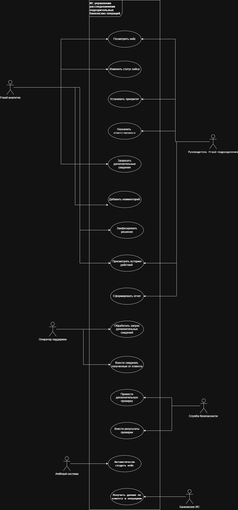
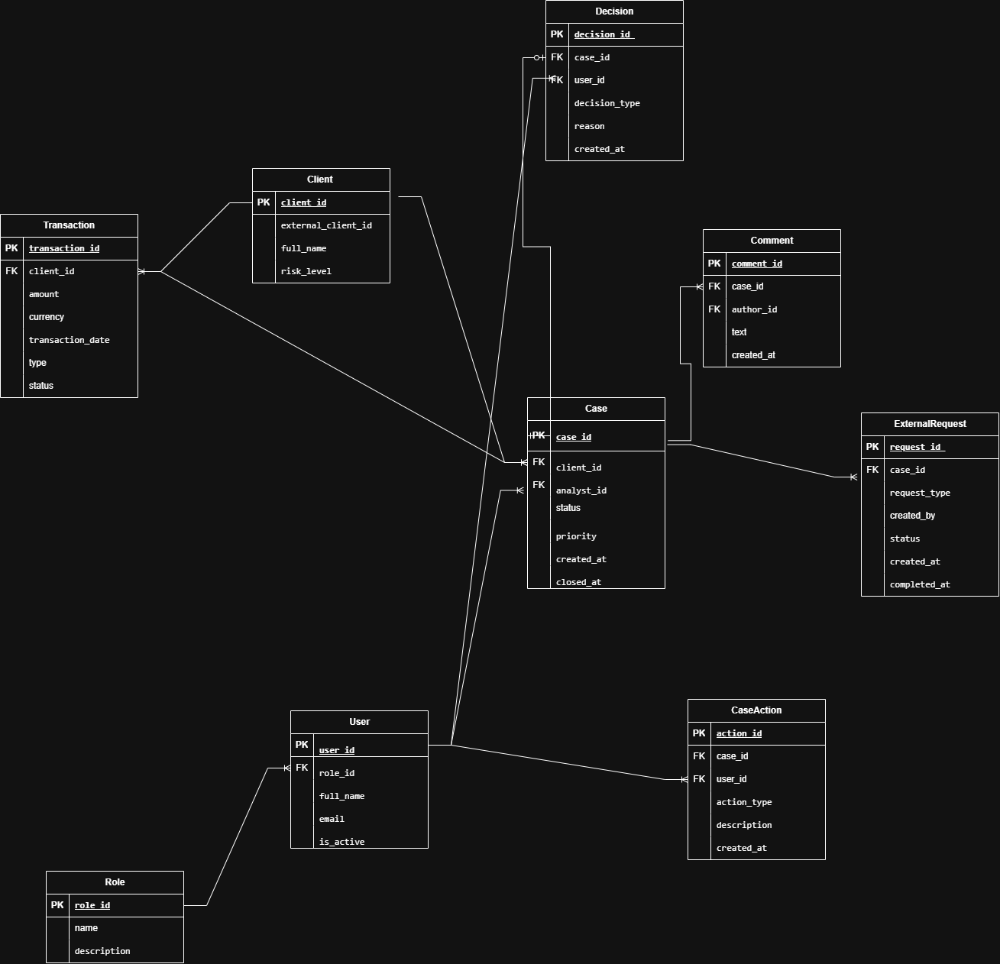
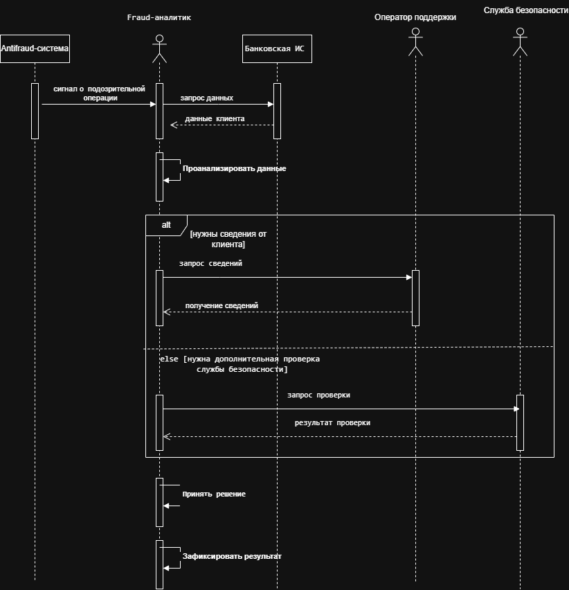
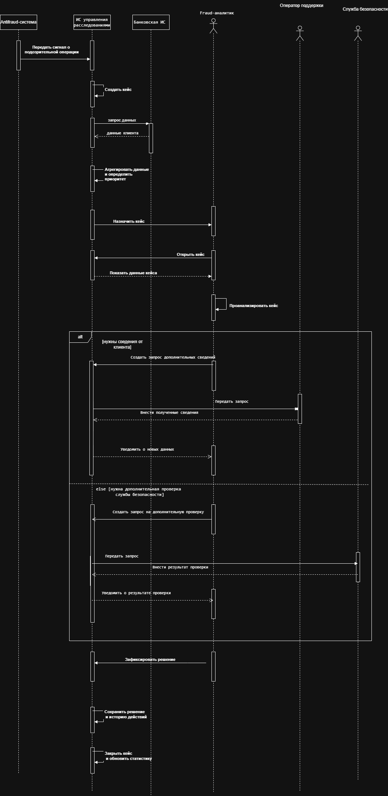
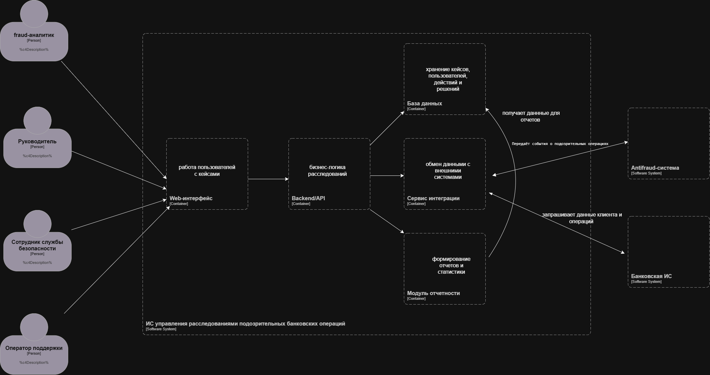
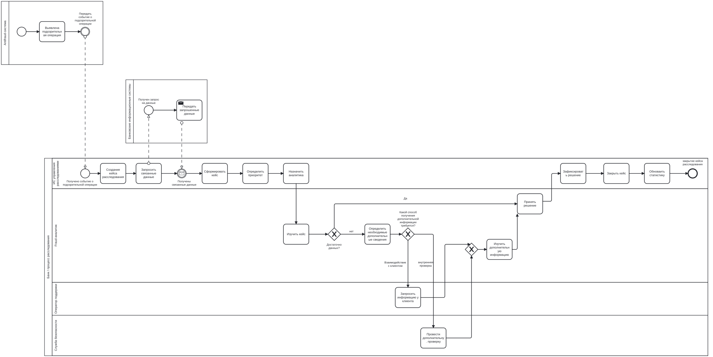

МИНИСТЕРСТВО НАУКИ И ВЫСШЕГО ОБРАЗОВАНИЯ  
РОССИЙСКОЙ ФЕДЕРАЦИИ

 

Федеральное государственное автономное образовательное учреждение  
высшего образования  
**«Национальный исследовательский университет ИТМО»**

 

Мегафакультет трансляционных информационных технологий  
Факультет прикладной информатики

   

# Лабораторная работа №4

## «Описание информационной системы с помощью различных нотаций»

по дисциплине  
**«Проектирование информационных систем»**

   

Выполнил студент группы № 3340  
**Гаенко Анастасия Константиновна**

 

Преподаватель:  
**Духанов Алексей Валентинович**

   

**Санкт-Петербург**  
**2026**

---

# Лабораторная работа №4
## Описание информационной системы с помощью различных нотаций

## 1. Общая характеристика системы

В рамках работы рассматривается информационная система управления расследованиями подозрительных банковских операций.

Проектируемая система предназначена для автоматизации процесса расследования после того, как существующая antifraud-система банка выявила потенциально подозрительную операцию. Непосредственное обнаружение мошеннических операций не входит в функции проектируемой системы.

Информационная система обеспечивает автоматическое создание кейсов расследования, получение связанных данных из банковских информационных систем, назначение ответственных сотрудников, ведение истории действий, получение дополнительных сведений, фиксацию результатов расследования, контроль статусов и формирование отчётности.

Основными пользователями системы являются fraud-аналитик, оператор поддержки, сотрудник службы безопасности и руководитель подразделения по противодействию мошенничеству. Внешними системами являются antifraud-система и банковские информационные системы.

---

## 2. UML-диаграмма вариантов использования

Для описания функциональных возможностей системы была построена UML-диаграмма вариантов использования.

На диаграмме представлены основные роли пользователей и доступные им функции.

**Fraud-аналитик** работает непосредственно с расследованием: просматривает кейсы, изменяет их статус, анализирует доступную информацию, создаёт запросы на получение дополнительных сведений, добавляет комментарии, просматривает историю действий и фиксирует итоговое решение.

**Оператор поддержки** обрабатывает запросы на получение дополнительных сведений и вносит в систему информацию, полученную при взаимодействии с клиентом.

**Сотрудник службы безопасности** выполняет дополнительные проверки и фиксирует их результаты в рамках соответствующего кейса.

**Руководитель подразделения** контролирует работу с кейсами, определяет их приоритет, назначает или переназначает ответственных аналитиков, просматривает историю расследований и формирует отчётность.

В качестве внешних акторов выступают существующая antifraud-система и банковские информационные системы. Antifraud-система передаёт события о подозрительных операциях, а банковские информационные системы предоставляют сведения о клиентах, операциях и связанных событиях.

Таким образом, диаграмма вариантов использования определяет границы проектируемой системы и основные способы взаимодействия пользователей и внешних систем с её функциональностью.

---

## 3. ERD-модель данных

Для описания структуры хранимых данных была построена ERD-диаграмма.

Центральной сущностью модели является **Case**, представляющая кейс расследования подозрительной банковской операции.

Сущность **User** содержит данные пользователей системы. Тип пользователя определяется связанной сущностью **Role**, что позволяет использовать единую модель для fraud-аналитиков, операторов поддержки, сотрудников службы безопасности и руководителей.

Сущность **Client** представляет клиента банка, в отношении операций которого проводится расследование. С клиентом связаны банковские операции, представленные сущностью **Transaction**.

Для ведения истории расследования используется сущность **CaseAction**, содержащая сведения о действиях пользователей с кейсом. Текстовые пояснения и дополнительная информация хранятся в сущности **Comment**.

Итог расследования представлен сущностью **Decision**, связанной с соответствующим кейсом и пользователем, принявшим решение.

Для ситуаций, когда в ходе расследования необходимо получить дополнительные сведения, используется сущность **ExternalRequest**. Она позволяет зафиксировать тип запроса, его статус, автора и время обработки.

Разработанная модель обеспечивает хранение основной информации, необходимой для создания и ведения кейсов, фиксации действий участников, дополнительных запросов и результатов расследований.

---

## 4. UML-диаграммы последовательности

Для основного процесса расследования подозрительной банковской операции были построены две UML-диаграммы последовательности: AS-IS и TO-BE.

### 4.1. Процесс AS-IS

В существующем процессе antifraud-система передаёт fraud-аналитику информацию о подозрительной операции.

Для получения необходимых сведений аналитик самостоятельно обращается к банковским информационным системам, получает данные клиента и операции и выполняет их анализ.

Если имеющихся сведений недостаточно, аналитик непосредственно взаимодействует с оператором поддержки либо сотрудником службы безопасности. Оператор поддержки предоставляет информацию, полученную при взаимодействии с клиентом, а служба безопасности выполняет дополнительную проверку.

После получения необходимых данных fraud-аналитик завершает анализ, принимает решение и фиксирует результат расследования.

Основным недостатком процесса AS-IS является большое количество ручных взаимодействий аналитика с различными участниками и информационными системами. Информация поступает из нескольких источников, а координация расследования в значительной степени выполняется самим сотрудником.

### 4.2. Процесс TO-BE

В целевом процессе событие о подозрительной банковской операции передаётся antifraud-системой непосредственно в информационную систему управления расследованиями.

После получения события система автоматически создаёт кейс и запрашивает необходимые сведения из банковских информационных систем. Полученные данные агрегируются в рамках единого кейса, после чего определяется его приоритет и назначается ответственный fraud-аналитик.

Аналитик получает назначенный кейс через информационную систему и проводит его анализ.

Если требуются дополнительные сведения, аналитик создаёт соответствующий запрос в системе. Система маршрутизирует его оператору поддержки или сотруднику службы безопасности. Полученные сведения и результаты проверки возвращаются в информационную систему, сохраняются в кейсе и становятся доступны аналитику.

После завершения анализа fraud-аналитик фиксирует итоговое решение в системе. Информационная система сохраняет результат и историю действий, закрывает кейс и обновляет статистические данные.

### 4.3. Сравнение AS-IS и TO-BE

В модели AS-IS fraud-аналитик самостоятельно взаимодействует с различными информационными системами и сотрудниками, собирает необходимые сведения и координирует получение дополнительной информации.

В модели TO-BE центральным элементом процесса становится информационная система управления расследованиями. Она автоматически создаёт кейс, агрегирует данные, обеспечивает маршрутизацию дополнительных запросов, сохраняет историю действий и фиксирует результаты расследования.

В результате уменьшается количество ручных операций аналитика, обеспечивается централизованное хранение информации и повышается прозрачность процесса расследования.

---

## 5. Описание архитектуры с использованием C4

Для представления основных элементов архитектуры разработана диаграмма C4 уровня Container.

Проектируемая информационная система представлена несколькими основными контейнерами.

**Web-интерфейс** обеспечивает взаимодействие пользователей с системой. Через него fraud-аналитики, операторы поддержки, сотрудники службы безопасности и руководители работают с кейсами и доступной им функциональностью.

**Backend/API** содержит основную бизнес-логику системы: создание и изменение кейсов, управление статусами и приоритетами, назначение аналитиков, обработку решений и взаимодействие с остальными компонентами системы.

**База данных** используется для хранения кейсов, пользователей, действий участников расследования, комментариев, запросов и итоговых решений.

**Сервис интеграции** обеспечивает взаимодействие проектируемой системы с внешними информационными системами. Через него поступают события от antifraud-системы и выполняется обмен данными с банковскими информационными системами.

**Модуль отчётности** отвечает за формирование статистики и управленческой отчётности на основании накопленных данных о расследованиях.

Использование такой архитектуры позволяет разделить пользовательский интерфейс, бизнес-логику, хранение данных, интеграционное взаимодействие и отчётность.

---

## 6. Анализ BPMN-модели процесса

В рамках предыдущей работы была разработана BPMN-модель целевого процесса расследования подозрительной банковской операции.

После построения UML-диаграмм вариантов использования и последовательности, ERD-модели и C4-диаграммы BPMN-модель была повторно проанализирована.

Существующая структура BPMN-модели уже отражает основные взаимодействия, уточнённые в ходе данной работы. Процесс начинается с выявления подозрительной операции внешней antifraud-системой и передачи события в информационную систему управления расследованиями.

После получения события автоматически создаётся кейс, выполняется запрос связанных данных из банковских информационных систем, формируется информационное наполнение кейса, определяется приоритет и назначается ответственный аналитик.

Fraud-аналитик изучает кейс и определяет достаточность имеющейся информации. При необходимости получения дополнительных сведений процесс предусматривает взаимодействие с оператором поддержки либо проведение дополнительной проверки службой безопасности. После получения информации аналитик продолжает рассмотрение кейса.

По завершении анализа принимается и фиксируется решение, после чего кейс закрывается, а накопленные данные используются для обновления статистики.

Проведённый в данной работе анализ подтвердил соответствие BPMN-модели уточнённой функциональной и архитектурной модели системы. Существенных структурных изменений процесса не потребовалось. Было уточнено понимание взаимодействия участников: дополнительные запросы и результаты проверок рассматриваются как часть единого кейса и обрабатываются посредством проектируемой информационной системы.

---

## 7. Вывод

В ходе лабораторной работы информационная система управления расследованиями подозрительных банковских операций была описана с использованием нескольких типов моделей.

UML-диаграмма вариантов использования позволила определить основных пользователей системы и доступную им функциональность. ERD-диаграмма описала структуру основных данных. Диаграммы последовательности AS-IS и TO-BE позволили сравнить существующий и целевой процессы и показать изменение взаимодействия участников после внедрения информационной системы.

Диаграмма C4 была использована для описания основных архитектурных элементов системы и их взаимодействия с пользователями и внешними информационными системами.

Повторный анализ BPMN-модели подтвердил её соответствие результатам дальнейшего проектирования. Предлагаемая информационная система централизует работу с расследованиями, автоматизирует получение и хранение информации, обеспечивает маршрутизацию дополнительных запросов и сохраняет полную историю работы с кейсом.